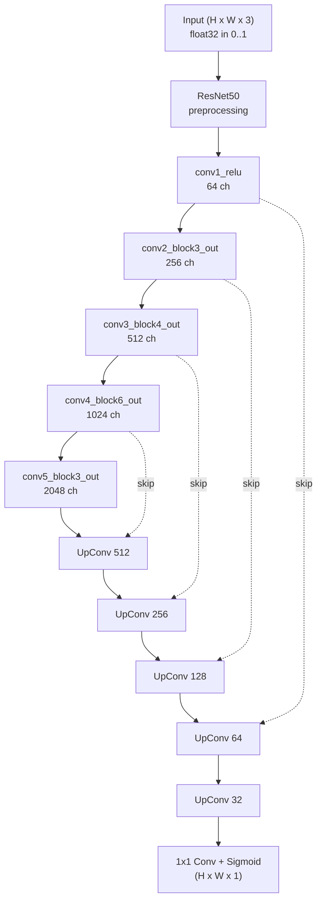
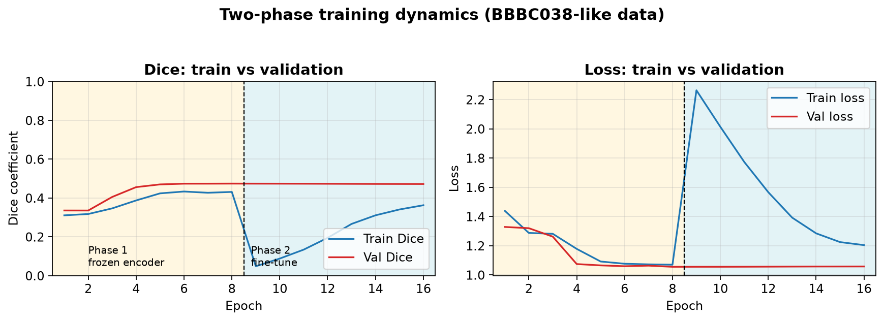
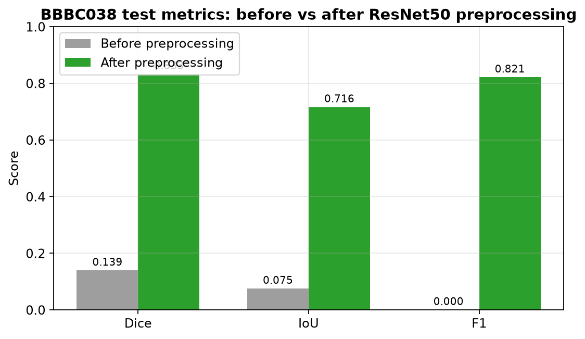

# Cell Segmentation with U-Net

[](https://www.python.org/)
[](https://www.tensorflow.org/)
[](https://github.com/Helios337/Cell-Segmentation/actions)
[](LICENSE)

Detect, segment, and count nuclei in fluorescence microscopy images using a **U-Net** with a pretrained **ResNet50** encoder and watershed-based separation of overlapping cells.

Built for the [BBBC038](https://data.broadinstitute.org/bbbc/BBBC038/) (Kaggle 2018 Data Science Bowl) nuclei benchmark, with first-class support for Google Colab.

## Table of Contents

- [Highlights](#highlights)
- [Architecture](#architecture)
- [Pipeline](#pipeline)
- [Installation](#installation)
- [Quick Start](#quick-start)
- [CLI Reference](#cli-reference)
- [Configuration](#configuration)
- [Training Strategy](#training-strategy)
- [Results](#results)
- [Evaluation Metrics](#evaluation-metrics)
- [Post-Processing](#post-processing)
- [Project Structure](#project-structure)
- [Testing](#testing)
- [License](#license)

## Highlights

- **U-Net + ResNet50 encoder** - ImageNet-pretrained features with proper caffe-style input preprocessing
- **Two-phase training** - frozen encoder first, then full fine-tuning
- **On-the-fly augmentation** - flips, rotations, brightness, contrast, noise, and blur every epoch
- **Regularization** - scaled decoder (30.5M params) + AdamW weight decay to curb overfitting
- **Target-based early stopping** - halt training as soon as validation Dice reaches your score
- **Combined loss** - BCE + Dice + Focal for extreme foreground/background imbalance
- **Watershed post-processing** - separates touching nuclei for accurate counting
- **Test-time augmentation (TTA)** - flip-consistent averaging for robust predictions
- **Full evaluation suite** - IoU, Dice, Precision, Recall, F1, and Count MAE

## Architecture

The U-Net follows the Ronneberger et al. design with a pretrained ResNet50 encoder.
Inputs are preprocessed with `tf.keras.applications.resnet50.preprocess_input`
(scale to `[0, 255]`, per-channel mean subtraction, BGR order) before entering
the encoder - this is required for the ImageNet weights to produce usable features.



- **Encoder**: ResNet50 pretrained on ImageNet (`conv1_relu` -> `conv5_block3_out`)
- **Bottleneck**: final ResNet50 feature map (2048 channels)
- **Decoder**: 4 blocks of `Conv2DTranspose` -> `Concatenate` (skip) -> `Conv2D` -> `Dropout` -> `Conv2D`
- **Output**: 1x1 `Conv2D` with sigmoid activation

Use `--decoder-scale 0.5` (the default) to halve the decoder channels, which
cuts the model from 41M to 30.5M parameters and reduces overfitting on small
datasets.

## Pipeline

```mermaid
graph LR
    A["BBBC038 / synthetic"] --> B["Download & extract"]
    B --> C["Load & resize 256 x 256"]
    C --> D["Split 468 / 101 / 101"]
    D --> E["Phase 1: frozen encoder"]
    E --> F["Phase 2: fine-tune"]
    F --> G["Evaluate test set"]
    G --> H["Watershed post-processing"]
    H --> I["Threshold optimization"]
    I --> J["Visualize & count"]
```



## Installation

### Local

```bash
git clone https://github.com/Helios337/Cell-Segmentation.git
cd Cell-Segmentation
python3 -m venv venv && source venv/bin/activate
pip install -e ".[dev]"
```

### Google Colab

1. Open a notebook and connect to a GPU runtime (Runtime -> Change runtime type -> GPU).
2. Run the setup helper:

```bash
!git clone https://github.com/Helios337/Cell-Segmentation.git
%cd Cell-Segmentation
!python colab_setup.py
```

Or set up manually:

```bash
!git clone https://github.com/Helios337/Cell-Segmentation.git
%cd Cell-Segmentation
!pip install -e .
!python main.py --data-source BBBC038 --target-dice 0.85
```

A Tesla T4 runs the full BBBC038 pipeline (download, train, evaluate) in roughly
20-25 minutes.

## Quick Start

```bash
# Train on BBBC038 nuclei data (default mode)
python main.py --data-source BBBC038

# Stop once validation Dice reaches 0.85
python main.py --data-source BBBC038 --target-dice 0.85

# Quick demo on synthetic data (no download needed)
python main.py --data-source synthetic --n-samples 50 --epochs-phase1 1 --epochs-phase2 1

# Evaluate a trained model on the test split
python main.py --mode eval --data-source BBBC038 --model-path best_model.keras

# Predict on a single image
python main.py --mode predict --image-path /path/to/cell.png --model-path best_model.keras
```

## CLI Reference

```bash
python main.py --mode {train,eval,predict} [options]
```

| Option | Default | Description |
|---|---|---|
| `--data-source` | `BBBC038` | `BBBC038` or `synthetic` |
| `--img-size` | `256 256` | Input height and width |
| `--epochs-phase1` | `10` | Epochs with frozen encoder |
| `--epochs-phase2` | `20` | Fine-tuning epochs |
| `--batch-size` | `8` | Batch size |
| `--lr-phase1` | `0.001` | Learning rate, phase 1 |
| `--lr-phase2` | `0.00001` | Learning rate, phase 2 |
| `--target-dice` | `0.0` | Stop when val Dice reaches this (0 = off) |
| `--decoder-scale` | `0.5` | Scale decoder channels (lower = fewer params) |
| `--weight-decay` | `0.0001` | AdamW weight decay |
| `--tta` / `--no-tta` | on | Test-time augmentation |
| `--optimize-thresholds` | on | Grid-search post-processing settings |
| `--threshold` | `0.5` | Binarization threshold |
| `--min-size` | `50` | Minimum cell size in pixels |

All options default to the values in `config.yaml` and can be overridden on the
command line.

## Configuration

Defaults live in `config.yaml` and are wired into the CLI by `apply_config_defaults`
in `main.py`:

```yaml
model:
  decoder_scale: 0.5
  weight_decay: 0.0001
training:
  target_dice: 0.0
```

## Training Strategy

1. **Phase 1** (frozen encoder): train the decoder only for 10 epochs at lr=1e-3
2. **Phase 2** (fine-tune): unfreeze the encoder, train the whole model for 20 epochs at lr=1e-5
3. **Target-based early stopping**: stop as soon as validation Dice reaches `--target-dice`
4. **Early stopping**: patience=10 on validation loss
5. **ReduceLROnPlateau**: factor=0.5, patience=5

The two-phase dynamics, measured on BBBC038-like data:



> **Why preprocessing matters.** Feeding raw `[0, 1]` pixels into the ResNet50
> ImageNet encoder degrades its features, so the frozen encoder never learns
> (validation Dice stalls near 0.17) and phase 2 overfits from a bad start.
> With correct caffe-style preprocessing, phase 1 reaches validation Dice
> ~0.78-0.81 in a single epoch on BBBC038. See
> [Results](#results) for the measured improvement.

## Results

On BBBC038 (Kaggle 2018 Data Science Bowl), test split (101 images), two
independent runs that both stopped at epoch 1 (`--target-dice 0.75` reached
immediately):

| Metric | Run 1 | Run 2 |
|---|---|---|
| Test Dice | 0.859 | 0.833 |
| Test IoU | 0.754 | 0.716 |
| Test Accuracy | 0.968 | 0.961 |
| Precision | 0.832 | 0.763 |
| Recall | 0.893 | 0.913 |
| F1 | 0.854 | 0.821 |
| Count MAE | 7.00 | 6.44 |
| Post-processed best IoU | 0.910 | 0.733 |

The impact of the ResNet50 input-preprocessing fix, measured on the same test
split:



Before preprocessing the model found essentially no cells (Count MAE 47.35);
after it, Count MAE drops to ~6.4 and segmentation F1 reaches ~0.82. Raise
`--target-dice` (or drop it) to train longer and push toward the top of the
range.

## Evaluation Metrics

| Metric | Description | Direction |
|---|---|---|
| IoU (Jaccard) | Intersection over Union | higher is better |
| Dice Coefficient | F1 score for segmentation overlap | higher is better |
| Precision | Fraction of predicted cells that are real | higher is better |
| Recall | Fraction of real cells that are found | higher is better |
| F1 | Harmonic mean of precision and recall | higher is better |
| Count MAE | Mean absolute error in cell count | lower is better |

## Post-Processing

Raw probability maps are turned into cell counts with:

1. Binarization at a threshold
2. Morphological cleanup (`remove_small_objects`)
3. Euclidean distance transform
4. Watershed to separate touching/overlapping nuclei

`optimize_post_processing` grid-searches the threshold and `min_size` for the
best IoU on a held-out sample, and the visualization step reuses those optimized
values. For a more stable threshold, optimize over the full test set rather than
a single random image.

## Project Structure

```
├── main.py                 # CLI pipeline runner (train / eval / predict)
├── model.py                # U-Net + ResNet50 encoder + training + evaluation
├── data_handler.py         # BBBC downloader + real/synthetic data loader
├── utils.py                # Augmentation, config loading, CSV export
├── config.yaml             # Default hyperparameters (loaded by main.py)
├── colab_setup.py          # One-shot Colab setup + training helper
├── docs/assets/            # Diagrams and result graphs used in this README
├── tests/                  # Unit tests (model, data handler, utils)
├── pyproject.toml          # Package metadata, ruff + pytest config
├── requirements.txt        # Runtime dependencies
├── Makefile                # Common commands (install, train, test, lint)
├── Dockerfile              # Containerized deployment
└── .github/workflows/ci.yml
```

## Testing

```bash
make test
# or
python -m pytest tests/ -v
```

The suite covers model construction, training, evaluation, TTA, data loading,
and augmentation (27 tests). Lint and format with:

```bash
ruff check .
ruff format --check .
```

## License

MIT
